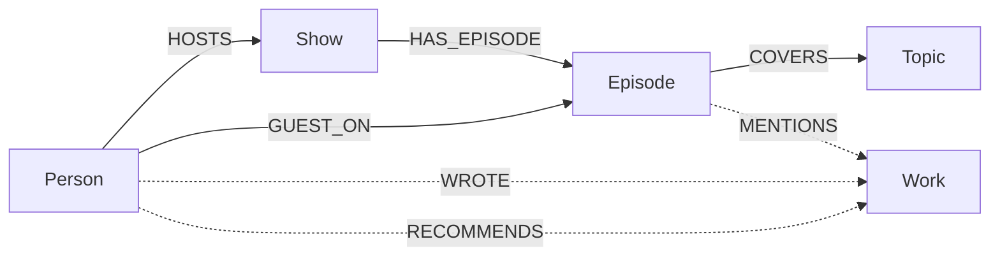

# Data model

Everything the page shows comes from five files in the site repository. Four are YAML
lists in `_data/`, one is a folder of markdown files, and a sixth is generated from them
at build time.

```
_data/podcast_shows.yml      one entry per show, including shows known only through a host
_data/podcast_people.yml     guests and hosts
_data/podcast_topics.yml     the controlled topic vocabulary
_data/podcast_works.yml      books, articles, papers, newsletters, talks
_listens/<date>-<show>-<slug>.md   one file per episode heard
assets/data/listens-graph.json     generated by Liquid at build time, never edited
```

| Page | Covers |
|---|---|
| [Shows, people, topics](entities.md) | The three entity files and their fields |
| [Listens](listens.md) | The episode file: front matter, naming, provenance |
| [Works](works.md) | The works file, mention kinds, catalogue rules |
| [Moments](moments.md) | The `moments` list and what it may contain |
| [Graph JSON](graph-json.md) | What the page reads, and the edge types |

## Identifiers

Every entity has an `id`: a lowercase snake-case slug of its normalised name. The slug
is one function of the name, in `add_listen.py`, so the same person added twice
converges on the same id:

| Input | Id | Rule applied |
|---|---|---|
| `Katie Malone` | `katie_malone` | lowercase, non-alphanumerics to `_` |
| `Tim O'Reilly` | `tim_oreilly` | apostrophes dropped |
| `Dr. Luis Serrano` | `luis_serrano` | honorifics (Dr, Prof, Mr, Mrs, Ms) dropped |
| `Donella H. Meadows` | `donella_meadows` | single-letter middle initials dropped |
| `Catalog & Cocktails` | `catalog_cocktails` | accents stripped, runs collapsed |

Listens are identified by file name (see [Listens](listens.md#file-name)) and
deduplicated by feed `guid`. The id scheme is borrowed from the private
`podcast-ingest-agent` repository's contracts, so ids can move between the two.

## Edges

The graph is derived, not stored. Each edge type comes from one field:



| Edge | From → To | Source field |
|---|---|---|
| `HAS_EPISODE` | Show → Episode | `show` on the listen |
| `HOSTS` | Person → Show | `hosts` in `podcast_shows.yml` |
| `GUEST_ON` | Person → Episode | `guests` on the listen |
| `COVERS` | Episode → Topic | `topics` on the listen |
| `MENTIONS` | Episode → Work | `mentions[].listen` in `podcast_works.yml` |
| `WROTE` | Person → Work | `authors` in `podcast_works.yml` |
| `RECOMMENDS` | Person → Work | `mentions[].by` on a `recommended` mention |

The dotted edges belong to the works layer, which is off until the "Works" toggle is on.
People and topics that nothing references are dropped on the client, so an unused topic
in the vocabulary does not float on its own.

## Who writes what

| File | Written by | Rewritten whole? |
|---|---|---|
| `podcast_shows.yml` | `add-show`, and `listen` (sets `color_slot`) | No, appended; the slot is a one-line insert |
| `podcast_people.yml` | `add-person` | No, appended |
| `podcast_topics.yml` | `add-topic` | No, appended |
| `podcast_works.yml` | `add-work` | **Yes**, every time, so comments in it do not survive |
| `_listens/*.md` | `listen`, `add-moment` | The file, yes; body notes are preserved |

Because `add-work` and `add-moment` rewrite files whole, one session writes to the
repository at a time.
