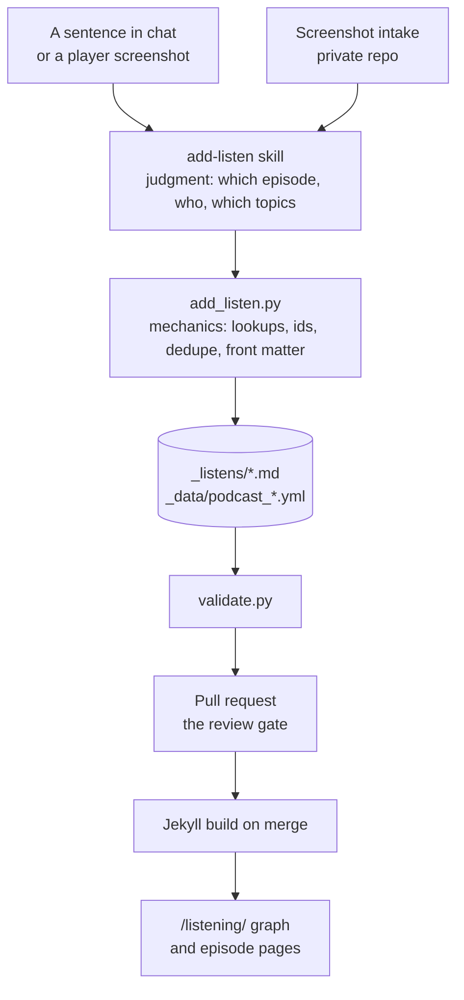

# The listening graph, documented

[barbhs.com/listening/](https://barbhs.com/listening/) shows the podcast episodes I have
listened to as a graph: shows, episodes, the people on them, the topics that connect
them, and the books and articles they mention. Each episode also has its own page.

This site explains how that works as of November 2026: what the data looks like, how an
episode gets in, what checks it passes, and what is still on the drawing board. It
describes the system as built. The three planning documents that led here stay in
`_planning/` as design history and are summarised in the [decisions log](decisions.md).

## The idea in one paragraph

Two moments matter in listening. The first is *while* listening: something lands, and
the cheapest thing I can do is take a screenshot of the player. The second is *later*,
when I say in a sentence what it sparked. The graph is built so that the first moment
costs nothing new (a screenshot into a folder) and the second is asked for in a batch,
in my words. Everything mechanical in between, from Apple lookups to id slugs to the
exact front matter of a file, is done by a script so that the data never drifts.

## Where to start

-   **Concepts**

    ---

    Shows, listens, people, topics, works, sparks and moments, and why colour is
    reserved for shows.

    [:octicons-arrow-right-24: Read the concepts](concepts.md)

-   **Data model**

    ---

    One markdown file per episode, four YAML data files, and a generated JSON
    that the page reads.

    [:octicons-arrow-right-24: See the files](data-model/index.md)

-   **Workflow**

    ---

    From "I just listened to X" or a screenshot to a reviewed pull request.

    [:octicons-arrow-right-24: Follow the pipeline](workflow/index.md)

-   **Reference**

    ---

    Every subcommand of `add_listen.py`, the lookup helpers, and the environment
    details that trip sessions up.

    [:octicons-arrow-right-24: Open the reference](reference/index.md)

## The pieces at a glance

| Piece | Where | What it owns |
|---|---|---|
| Source of truth | `_listens/`, `_data/podcast_*.yml` | Every fact the page shows |
| Mechanics | `scripts/listens/add_listen.py` | Lookups, ids, duplicate checks, colour slots, file layout |
| Judgment | `.claude/skills/add-listen/SKILL.md` | Which episode, who the guests are, which topics, my spark |
| Screenshot intake | `podcast-ingest-agent/screenshots/` (private) | Ledger, burst merging, episode matching |
| Checks | `scripts/listens/validate.py`, two test files | Ids resolve, dates parse, no duplicates, moments are safe to publish |
| Page | `listening/index.html`, `_layouts/listen.html` | The D3 graph and the episode pages |

## What this site never contains

The site repository is public. These docs describe the shape of the private ledger and
the rules that act on it, but never passage text from a player's transcript, a
screenshot image, a device name, or the ledger itself. See
[Screenshot intake](workflow/screenshot-intake.md#what-stays-private).
