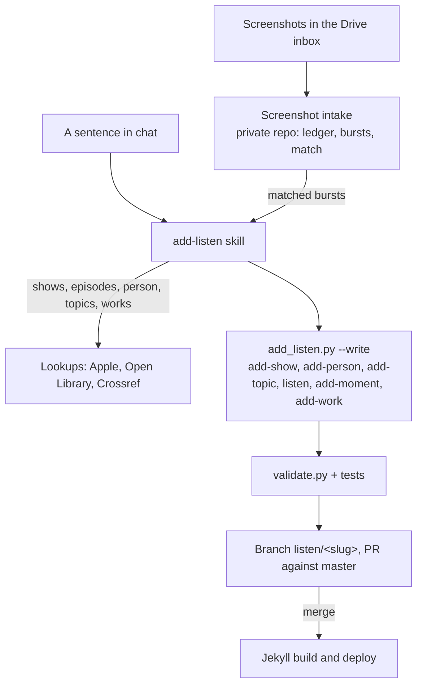

# Workflow

Two ways in, one path out. An episode enters either from a sentence in a Claude Code
session ("I just listened to X, add it") or from screenshots of the player. Both end in
`add_listen.py` writing files, `validate.py` checking them, and a pull request that I
review before anything is published.

| Step | Page |
|---|---|
| From a sentence to a file | [Adding a listen](adding-a-listen.md) |
| From a screenshot to a moment | [Screenshot intake](screenshot-intake.md) |
| What must pass before a PR | [Validation and tests](validation.md) |
| Branch, commit, PR, deploy | [Publishing and review](publishing.md) |

## Rules every session keeps

These are the standing rules from the planning documents, restated as the contract a
session works under.

- **The spark is mine.** Never drafted unless I ask; then flagged `spark_draft` and never
  published. My words are recorded verbatim, light punctuation fixes only.
- **Metadata comes from the lookup**, never from memory and never from a screenshot alone.
  If the episode cannot be found, say so.
- **`add_listen.py` does the mechanical work.** No hand-written `_listens/` files, no
  re-derived ids.
- **Hosts are not guests.** The script refuses a host of the show in `--guests`.
- **Bios come from the episode description**, one line, with their source recorded.
- **On-screen transcript text is "as shown"**, never a verified quote, and never in the
  public repository.
- **One session writes to the repository at a time.** Two of the subcommands rewrite
  files whole.
- **Ask when a choice is mine** (which of three candidate episodes, a new topic, the
  spark); do not ask about what the lookup settles.
- **No generated-UI tells on the page.** The October design review removed them; they
  stay out.
