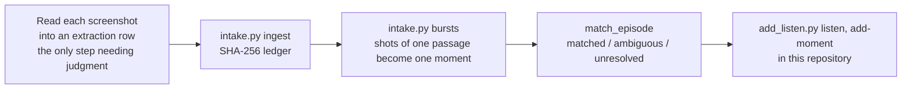

# Screenshot intake

The cheapest log is a screenshot of the player at the moment something lands. The
intake turns a folder of those into moments on logged episodes. The deterministic part
lives in the private repository `podcast-ingest-agent`, under `screenshots/`; the
writing happens in this repository through `add_listen.py`.

## What stays private

The private repository holds the ledger, and the ledger holds the passage text that was
visible in each screenshot: the player's transcript of someone else's words, errors
included. That text, the screenshot images, and the device details never enter this
repository. What crosses over is a show, an episode, a position and a chapter title.

| Thing | Where | Why |
|---|---|---|
| Screenshot files | Google Drive, "Podcast screenshots inbox" | Private; reachable from the phone's share sheet |
| Extraction ledger (`ledger.jsonl`) | `podcast-ingest-agent/screenshots/` | Holds third-party transcript text |
| Episode, moment position, my spark | This repository, through `add_listen.py` | Public-safe |

Files stay in the inbox after processing. The ledger records what was done; nothing is
moved or deleted, so a failed run can simply be repeated.

## What a screenshot carries

From the first ten test shots (one app, June to December 2025):

| Field | Readable | Note |
|---|---|---|
| Show name | 10 of 10 | Often cut off |
| Playback position | 9 of 10 | The tenth was an episode page showing minutes left |
| Total duration | 9 of 10 | |
| Episode title | 3 full, 6 cut off, 1 illegible | The title scrolls; shots from one burst show different fragments that join into the whole |
| Passage text | 6 of 10 | Transcript view, with recognition errors |
| Chapter title | 6 of 10 | Auto-generated by the player |
| A note from me | 0 of 10 | The shot says "this mattered", never why |
| Date and time taken | 10 of 10 | From the file name, `Screenshot_YYYYMMDD-HHMMSS.png`, local time |

## The flow

1. **Read.** A person or a model reads each screenshot into one extraction row:
   `file_name`, `file_sha256`, `taken_at`, `view` (now_playing, transcript or
   episode_page), `show_text` as shown, `title_fragments` each with `cut_left` and
   `cut_right` flags, `position_s`, `total_s`, `chapter`, `passage_as_shown`, and who
   or what read it. A letter visibly clipped at a cut edge is left out, and
   `cut_left: false` means the title starts here; matching relies on that flag.
2. **Ingest.** Rows the ledger has not seen are appended. Same image bytes or same file
   name is a repeat.
3. **Bursts.** Shots of one show, same total duration (two seconds of tolerance),
   positions within five minutes, taken within fifteen minutes, are one moment. The
   earliest position is kept, and title fragments are joined where their ends overlap
   by at least four characters or one contains the other.
4. **Match.** Each burst is matched against the show's episode list, from Apple's latest
   200 or from the RSS feed.
5. **Write.** In this repository: `add-show` if the show is new, `listen` if the episode
   is new, then `add-moment` with the burst's earliest position and chapter.

The session stops after step 4 and shows the match report before writing anything.

## The matching rules

`match_episode(burst, episodes)` returns a status and the reasons, and never picks
between candidates.

1. An episode published **after** the screenshot was taken is impossible.
2. Every title fragment must fit the title, respecting which edges were cut. A
   fragment with `cut_left: false` must start the title; one with `cut_right: false`
   must end it.
3. Duration only breaks ties. If more than one episode fits and exactly one is within
   three seconds of the screen's total, that one wins. A duration mismatch never rules
   an episode out, on the untested assumption that players insert ads and report
   different totals.

| Status | Meaning |
|---|---|
| `matched` | Exactly one episode fits and there was at least one legible title fragment |
| `ambiguous` | More than one fits; the candidates are listed |
| `unresolved` | None fits |

A burst with no legible title can never be `matched`; it is reported as ambiguous or
unresolved with the reason "no legible title".

## No duplicates: four checks, in order

Re-running the whole inbox must change nothing.

1. **File.** SHA-256 of the image bytes, with the original file name as a second key for
   re-saved copies.
2. **Burst.** The window rules above.
3. **Episode.** `add_listen.py` refuses a second listen for the same guid; a new moment
   on a logged episode updates that file, and `add-moment` ignores a second mark within
   a minute on the same day.
4. **Other sources.** A future Spotify export or share-sheet path resolves to the same
   guid and adds to an existing listen rather than creating one.

## Tests and findings

`test_intake.py` has twenty tests and runs without network, against the ten test rows
and a fixture of 390 Catalog & Cocktails episodes. They cover file-name times, clock
parsing, fragment joining in any order, cut edges, idempotent ingest, burst windows,
and the matching rules, including that a four-shot burst picks the full episode over its
"TAKEAWAYS" clip, that one weak shot alone is ambiguous rather than guessed, and that
duration breaks a tie but never excludes.

The first real run (16 November 2026): ten files were six moments in six episodes.
Five matched, with durations within a second of the feed. One, a shot of The Moth with
no legible title, fit 99 episodes and was reported ambiguous. Four of the five were
written through `add_listen.py` in one pull request; the fifth was an episode older
than Apple's latest 200, which the `listen` subcommand cannot yet take. The backlog in
the inbox is estimated at about fifty screenshots.

## The spark call

Moments arrive without sparks. The plan is a later batch session that lists moments
without a spark, reads me the passage (from the private ledger), and takes my sentence
verbatim, skips allowed. It is not built; see the [roadmap](../roadmap.md).
